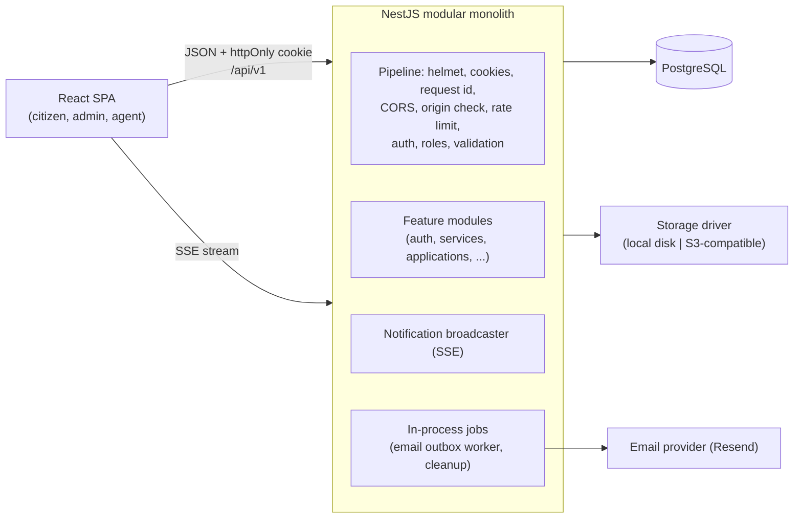

# Fast ID System: Backend System Design

**Version:** 1.1  **Stack:** NestJS 10 (TypeScript, strict) · Node.js 20 LTS (engines `>=20`) · PostgreSQL 15+ · Prisma (5/6)  
**Inputs:** `docs/Fast_ID_API_Contract.md` (1.0.3-mvp) and `docs/Database_Design.md` + `db/schema.sql`  
**Rule of the project:** the contract is the law. This document explains *how* to build it; it never changes *what* the API does.

---

## 1. Goals and constraints

- Build the whole REST API of the contract (63 endpoints, one envelope, one error vocabulary) as an MVP that can grow into a government-scale platform without a rewrite.
- One developer builds it, so **simplicity wins**: a modular monolith, boring technology, few moving parts, no infrastructure beyond Node, PostgreSQL and a file store.
- Correctness first: workflow transitions are transactional and race-safe; every important action is audited; personal data is protected.
- The frontend team builds against mocks in parallel, so the API must match the contract exactly (names, enums, status codes, error codes).

## 2. Architecture at a glance



Everything runs in one Node process. State lives in PostgreSQL and the storage driver, so the process is restartable at any time. The only in-memory state is the failed-login limiter and the SSE connection registry (both rebuild themselves; see limits in §15).

## 3. Decision log

| # | Decision | Choice | Why | Revisit when |
|---|---|---|---|---|
| D-01 | Architecture | Modular monolith | One deployable, simple transactions across modules, easy for one developer | Several teams need independent deploys |
| D-02 | Framework | NestJS 10, TypeScript `strict`, Node 20 LTS | The team's stated choice; modules, DI and guards fit this API | never for the MVP |
| D-03 | Data access | **Prisma** (5/6), database-first (manual timestamped SQL migrations applied via `prisma migrate deploy`, then `db pull` + `generate`; never `prisma migrate dev`) | Type-safe queries without shadow-DB drift dropping raw SQL triggers, checks, partial indexes, or deferred FKs; row locks use `$queryRaw` | Heavy reporting queries (use raw SQL or Kysely for those) |
| D-04 | Validation | `class-validator` + `class-transformer` with a global `ValidationPipe` (`whitelist`, `forbidNonWhitelisted`, `transform`) and a custom exception factory | Gives the contract's `UNKNOWN_FIELD` and `VALIDATION_ERROR` shapes exactly | n/a |
| D-05 | Auth | `@nestjs/jwt` (HS256) in an httpOnly cookie, own guards, passwords with `argon2id` | Contract §0.9; no Passport needed for one strategy | Mobile clients (Bearer) |
| D-06 | Rate limiting | `@nestjs/throttler` for per-route limits + bounded custom in-memory limiters (TTL pruning + max-entry cap) behind an interface | Single instance MVP; bounded maps prevent OOM under random-identifier floods | More than one API instance (move to Redis) |
| D-07 | Email | Resend SDK behind an `EmailProvider` interface, via a **transactional outbox** table with a `locked_until` lease | Emails are never lost, never break a request, and external HTTP sends never hold a DB transaction or lock | Another provider (swap the implementation) |
| D-08 | Live updates | Server-Sent Events from an in-memory broadcaster with explicit disconnect on auth invalidation and JWT `exp` | Matches contract §6.6; prevents revoked/expired sessions from keeping open streams | More than one API instance (Redis pub/sub) |
| D-09 | Files | `StorageDriver` interface: `LocalDisk` (dev) and S3-compatible (prod); content sniffing with an own tiny magic-byte check for JPEG, PNG and PDF | Only three types are allowed, so no dependency is needed | More file types |
| D-10 | IDs and numbers | UUIDs generated by PostgreSQL; `application_number` from a DB sequence; credential number and QR token generated in code with crypto-grade randomness | Unique and race-free | n/a |
| D-11 | Logging | `pino` (via `nestjs-pino`) with a request id and redaction of cookies, passwords and tokens | Structured, fast | n/a |
| D-12 | Config | `@nestjs/config` + a `zod` schema that **fails the boot** if a variable is missing or invalid | Misconfiguration is caught immediately | n/a |
| D-13 | Scheduling | `@nestjs/schedule` | Two small jobs | A real queue (BullMQ) if jobs multiply |
| D-14 | Testing | Jest + Supertest against a real PostgreSQL in Docker | The rules live in SQL constraints, so mocks would hide bugs | n/a |
| D-15 | Delivery code storage | plain `char(6)`, only while `OUT_FOR_DELIVERY` | The citizen must see it (contract §9) | n/a |
| D-16 | Credential expiry | derived at read time, no job | Always correct, nothing to schedule | n/a |
| D-17 | Status history notes | two columns: `citizen_note` and `staff_note` | The citizen must never see staff notes | n/a |
| D-18 | Re-publishing an unchanged service | flips availability back to `PUBLISHED` without a new version | Avoids duplicate versions (contract §8.6) | n/a |
| D-19 | Time zones | store UTC; use `Africa/Cairo` only for CSV and dashboard day boundaries | Contract §0.6 | n/a |
| D-20 | Deletion | no soft delete; drafts are the only deletable application | Legal records must remain | Data-protection requests |
| D-21 | Missing `Origin` header | treated as not allowed on state-changing requests | Contract §0.9 CSRF defence | n/a |
| D-22 | Regex safety (admin-defined `pattern`) | 200-char limit, `safe-regex2` check, reject backreferences (`\1`–`\9`, `\k<...>`) and lookarounds (`(?=`, `(?!`, `(?<=`, `(?<!`), input capped at 2,000 characters | Prevents ReDoS from catastrophic backtracking or non-regular constructs | Add `re2` if untrusted users ever author schemas |
| D-23 | Logout auth handling | `POST /auth/logout` is `@Public()` (skips `AuthGuard` and `PasswordChangeGuard`, keeps `OriginGuard`) | Contract §1.5 requires logout to clear the cookie and return `200` even for expired/invalid sessions while preventing cross-site logout CSRF | n/a |
| D-24 | Write `Content-Type` enforcement | Writes with a body require `application/json` (or `multipart/form-data` on §4.9); any disallowed `Content-Type` returns `415` even with an empty body; bodyless writes allow omitted `Content-Type`, empty body with `application/json`, or `{}` | Satisfies CSRF defense (§0.9) without breaking bodyless `POST`/`DELETE` endpoints (§0.2) | n/a |
| D-25 | Staff & attachment concurrency locks | Advisory lock `staff:admin_active` for `LAST_ADMIN`; shared `assign:<governorate>` + agent row lock across auto-assign, manual assign, and agent deactivation; `applications FOR UPDATE` in attachment upsert tx | Eliminates 0-admin races, deactivated-agent-with-active-delivery races, and uploads mutating submitted applications | n/a |
| D-26 | Attachment download hardening | `Content-Security-Policy: default-src 'none'; sandbox` and RFC 5987 UTF-8 `Content-Disposition` filename encoding on §4.10 | Blocks embedded script execution in inline-rendered PDFs and supports Arabic filenames safely | Dedicated separate download origin for huge scale |
| D-27 | Graceful shutdown & observability | `enableShutdownHooks()`: drain HTTP, close SSE streams, stop schedulers, disconnect Prisma; structured pino request metrics (status, latency, request id) + `/health` DB probe | Clean zero-corruption restarts and fast diagnosis during demo and production | OpenTelemetry / Prometheus metrics |

## 4. Project structure

```
fast-id-api/
  prisma/
    schema.prisma                 (generated by db pull, committed)
    migrations/0001_init/migration.sql   (= schema.sql)
  src/
    main.ts                       bootstrap: helmet, cookies, CORS, pipes, filters, prefix /api/v1
    app.module.ts
    config/                       env.schema.ts (zod), configuration.ts
    common/
      errors/                     app-exception.ts, error-codes.ts (registry, section 6.2)
      filters/                    all-exceptions.filter.ts
      interceptors/               response-envelope.interceptor.ts, cache-control.interceptor.ts
      pipes/                      validation.pipe.ts (custom exception factory)
      guards/                     auth.guard.ts, roles.guard.ts, origin.guard.ts, password-change.guard.ts
      decorators/                 public.decorator.ts, roles.decorator.ts, current-user.decorator.ts, public-cache.decorator.ts
      dto/                        pagination.dto.ts, localized.dto.ts, money.dto.ts
      utils/                      crypto.ts, dates.ts, national-id.ts, phone.ts, mask.ts, csv.ts
    database/                     prisma.service.ts, transaction.ts (withTx, lockApplication)
    modules/
      auth/            users/            reference/        settings/
      services/        applications/     attachments/      credentials/
      deliveries/      notifications/    email/            audit/
      stats/           health/           storage/          seed/
  test/                           e2e specs + helpers
  docker-compose.yml              postgres for dev and CI
  .env.example
```

### 4.1 Modules and responsibilities

| Module | Contract sections | Owns | Depends on |
|---|---|---|---|
| `auth` | §1 | login, register, me, logout, password flows, session cookie, failed-login limiter | users, email, audit |
| `users` | §10.1 to §10.5 | citizens and staff data access, admin management endpoints | audit |
| `reference` | §2.1, §2.3 | governorates list, health | database |
| `settings` | §2.2, §10.8 | singleton settings | audit |
| `services` | §3, §8 | catalog (public), admin editor, publish workflow, definition validator, application-data validator | audit |
| `applications` | §4, §7 | citizen endpoints, admin review, **workflow engine** (all status transitions), CSV export, payment placeholder | services, attachments, credentials, deliveries, notifications, email, audit |
| `attachments` | §4.9 to §4.11 | upload pipeline, download | storage, applications |
| `credentials` | §5, §7.7 | issuance, verification, revoke | audit, notifications, email |
| `deliveries` | §9 | admin and agent endpoints, auto-assignment, delivery code | audit, notifications, email |
| `notifications` | §6 | persistence, read state, SSE broadcaster | none (others call it) |
| `email` | §11 | outbox, worker, templates, provider | none (others enqueue) |
| `audit` | §10.6, §11 | append helper, list endpoint | none |
| `stats` | §10.7 | dashboard queries | database |
| `storage` | none | storage drivers | none |
| `seed` | none | first admin, demo data | users, services |

**Dependency rule:** the arrows above go one way. `applications` orchestrates; `notifications`, `email` and `audit` are leaves that never import other feature modules. Cross-module calls inside a transaction pass the Prisma transaction client (`tx`) explicitly.

## 5. Request pipeline (order matters)

1. `helmet` (security headers, contract §0.17) and `cookie-parser`.
2. Request id middleware (generates `X-Request-Id`, ignores the client's).
3. CORS with an exact allow-list from `CORS_ORIGINS`, credentials on (contract §0.14).
4. Body parser with a 100 KB JSON limit (`PAYLOAD_TOO_LARGE`), then content-type check (`UNSUPPORTED_MEDIA_TYPE`) on write requests (D-24: reject any non-JSON `Content-Type` other than multipart on §4.9 even with an empty body; allow bodyless writes with omitted `Content-Type`, empty body + `application/json`, or `{}` + `application/json`).
5. `OriginGuard`: state-changing requests must carry an allowed `Origin` (`ORIGIN_NOT_ALLOWED`).
6. `ThrottlerGuard` with named limits (§5.5).
7. `AuthGuard` (skipped for `@Public()` routes, including `POST /auth/logout`).
8. `PasswordChangeGuard` (applies to authenticated routes only — public routes ignore cookies per §0.15; blocks everything except `me` and `change-password` when `mustChangePassword`, while `logout` is `@Public()`).
9. `RolesGuard` (`@Roles(...)`).
10. `ValidationPipe` (body, query, params).
11. Controller, then service (business rules and transactions).
12. `ResponseEnvelopeInterceptor` (success envelope; paginated results carry `meta`) and `CacheControlInterceptor` (default `no-store`).
13. `AllExceptionsFilter` (error envelope; unknown errors become `INTERNAL_ERROR` and are logged with the request id, never leaked).

### 5.1 Envelope and errors
- Services throw `AppException(code, message, { field, details })`. HTTP status comes from the **error registry** (`error-codes.ts`), a single map `code -> status` generated from the contract (Appendix A). Controllers never pick status codes.
- A unit test parses `docs/Fast_ID_API_Contract.md`, extracts every error code, and fails if one is missing from the registry or has a different status. This keeps code and contract from drifting.
- Database errors are translated in one place: unique violation on `users_email_unique` becomes `EMAIL_ALREADY_REGISTERED`, on `users_national_id_unique` becomes `NATIONAL_ID_ALREADY_REGISTERED`, on `applications_one_active_per_service` becomes `ACTIVE_APPLICATION_EXISTS`, on `services_pkey` becomes `SERVICE_ALREADY_EXISTS`; other violations are bugs and become `INTERNAL_ERROR`.
- Lists return `{ data, meta }` via a `Paginated<T>` return type that the interceptor recognises. Deletes return `{ id, deleted: true }`.

### 5.2 Validation
- DTO classes per endpoint with `class-validator`. `forbidNonWhitelisted` turns any extra property into `UNKNOWN_FIELD` (with the offending path, including inside nested objects).
- The custom exception factory builds `VALIDATION_ERROR` with `details: [{ field, code, message }]`, mapping constraints to codes: required/empty to `REQUIRED`, regex and format to `INVALID_FORMAT`, min/max length to `TOO_SHORT`/`TOO_LONG`, numeric ranges to `OUT_OF_RANGE`, enum/type to `INVALID_VALUE`. The first detail is mirrored in `message` and `field`.
- Strings are trimmed by a `@Trim()` transform before validation. Email is lowercased, phones normalized to `01XXXXXXXXX` (`utils/phone.ts`).
- Dynamic content (`applications.data`, service `formSchema`) is validated by dedicated validators in the `services` module (§7.6), not by decorators.
- Query parameters use DTOs too: `page`, `pageSize`, `sort` (checked against an allow-list per endpoint), comma lists, booleans as the literal strings `true`/`false`.

### 5.3 Authentication and sessions
- **Cookie:** `fid_session`, `HttpOnly`, `Path=/`, `Secure` unless `NODE_ENV=development`, `SameSite` and optional `Domain` from env, `Max-Age=43200`.
- **Token:** JWT HS256 with payload `{ sub: userId, tv: tokenVersion }` and a 12-hour expiry. The role is **not** trusted from the token.
- **AuthGuard:** verify the JWT, load the user by primary key, require `is_active` (else `ACCOUNT_DISABLED`) and `token_version === tv` (else `UNAUTHENTICATED`). One indexed lookup per request is fine at this scale.
- **Login:** accept `identifier` as an email (contains `@`) or a 14-digit national ID. Always run a password verification (against a dummy hash when the user does not exist) so timing does not reveal whether an account exists. Check the password **before** `is_active`, so `ACCOUNT_DISABLED` is only revealed to someone who knows the password. Failed attempts feed the failed-login limiter (§5.5).
- **Register:** validates the national ID structure and derives birth date and gender (`utils/national-id.ts`), inserts the citizen, signs in, returns 201.
- **Change password:** verify current password, apply the strength rules, `token_version = token_version + 1`, `must_change_password = false`, enqueue `PASSWORD_CHANGED` email (Contract §11), commit, disconnect open SSE streams (`NotificationsBroadcaster.disconnectUser`), and issue a fresh cookie for the current session.
- **Forgot password:** always `200 { requested: true }`. If an active account exists, create a random 32-byte token, store its SHA-256 hash with a 30-minute expiry (computed via DB `now() + interval '30 minutes'`; invalidate older unused tokens for that user), enqueue the `PASSWORD_RESET` email containing `FRONTEND_BASE_URL/reset-password?token=...`.
- **Reset password:** look up by hash, require unused and unexpired (`INVALID_RESET_TOKEN` otherwise), set the new hash, `token_version + 1`, mark the token used, write the audit row, enqueue `PASSWORD_CHANGED`. All in one transaction; after commit disconnect open SSE streams (`NotificationsBroadcaster.disconnectUser`).
- **Password rules:** 8 to 128 characters, at least one letter and one digit, must not contain the email's local part (when that local part is at least 3 characters, case-insensitive) or the national ID.
- **Logout:** `@Public()` (behind `OriginGuard`), clears the cookie, disconnects the user's SSE streams if a valid `sub` can be decoded from the cookie, and always returns `200 { loggedOut: true }` (including for expired, invalid, or missing cookies).
- **Staff creation:** admin supplies `temporaryPassword`, `must_change_password = true`.

### 5.4 Authorization
`@Roles('ADMIN')`, `@Roles('CITIZEN')`, `@Roles('AGENT')`, or none for any authenticated role; `@Public()` for open routes. Ownership is enforced in the service layer by always querying with the caller's id (for example `WHERE id = $1 AND citizen_id = $2`); a miss returns the resource's `*_NOT_FOUND`, never `FORBIDDEN`.

### 5.5 Rate limiting (contract §0.13)

| Route | Limit | Implementation |
|---|---|---|
| `POST /auth/login` | 10 per 15 min per IP | Throttler named config `login-ip` |
| `POST /auth/login` | 5 **failed** attempts per 15 min per (IP + identifier) | custom limiter: bounded in-memory map (periodic TTL pruning every 5 min + 50,000-entry cap) keyed by `ip:lower(identifier)`; only failures count; reset on success |
| `POST /auth/register` | 5 per hour per IP | Throttler |
| `POST /auth/forgot-password` | 3 per hour per IP and 3 per hour per email | Throttler + bounded custom in-memory map by lowercased email (TTL pruning + 50,000-entry cap) |
| `POST /auth/reset-password` | 10 per hour per IP | Throttler |
| `POST /auth/change-password` | 5 per 15 min per user | Throttler with user key |
| `GET /verify/:qrToken` | 30 per minute per IP | Throttler |
| `POST /applications/:id/attachments` | 30 per 10 min per user | Throttler with user key |
| `POST /agent/deliveries/:id/deliver` | 20 per minute per user (plus the code lock) | Throttler with user key |
| `GET /admin/applications/export` | 5 per minute per user | Throttler with user key |
| everything else | 120 per minute per IP | global Throttler |

Behind a proxy, set `TRUST_PROXY` so the real client IP is used. Rejections return `429 RATE_LIMITED` with `Retry-After`.

### 5.6 Caching headers
`CacheControlInterceptor` sets `no-store` by default. Routes decorated with `@PublicCache(seconds)` get `public, max-age=N` (and `stale-while-revalidate=300` for services): governorates 86400, settings 60, services 60. All responses get `Vary: Origin`.

### 5.7 Configuration (names only; values come from the environment)

| Variable | Required | Notes |
|---|---|---|
| `NODE_ENV`, `PORT` | yes | |
| `DATABASE_URL` | yes | PostgreSQL connection string |
| `JWT_SECRET` | yes | at least 32 random bytes |
| `COOKIE_SAMESITE`, `COOKIE_DOMAIN` | no | default `lax`, no domain |
| `CORS_ORIGINS` | yes | comma list, exact origins |
| `FRONTEND_BASE_URL` | yes | used in email links |
| `TRUST_PROXY` | no | hop count or `false` |
| `EMAIL_PROVIDER_API_KEY`, `EMAIL_FROM` | prod | with `EMAIL_DRIVER=resend` or `log` (dev prints emails to the log) |
| `STORAGE_DRIVER` (`local` or `s3`) | yes | |
| `STORAGE_LOCAL_PATH` | local | outside any web root |
| `STORAGE_BUCKET`, `STORAGE_ENDPOINT`, `STORAGE_ACCESS_KEY`, `STORAGE_SECRET_KEY`, `STORAGE_REGION` | s3 | |
| `PAYMENT_MODE` | yes | `mock` or `disabled` |
| `SEED_ADMIN_EMAIL`, `SEED_ADMIN_PASSWORD` | first boot only | optional in Zod schema; checked at boot only when zero `ADMIN` rows exist (fails boot if missing and no admin exists yet) |
| `LOG_LEVEL` | no | |

The `zod` schema in `config/env.schema.ts` validates all of it at startup (for example `JWT_SECRET` length, valid URLs, `CORS_ORIGINS` never `*`).

### 5.8 Security checklist (enforced by tests where possible)
httpOnly cookie only; no tokens in bodies; argon2id; no account enumeration (login, forgot-password); strict CORS and origin check; whitelist validation everywhere; parameterized queries only (Prisma and `$queryRaw` with tagged templates, never string concatenation); file content sniffing; files outside the web root with generated names; authenticated file streaming with `nosniff`, `Content-Security-Policy: default-src 'none'; sandbox`, and RFC 5987 filename encoding; masked national IDs (`29**********45`) outside owner/admin views; `deliveryCode` never included in admin (`AdminApplication` omits `delivery`) or agent responses; SSE streams closed on logout, password change/reset, deactivation, and JWT `exp`; no personal data in logs, audit metadata or errors; CSV formula-injection guard (`=`, `+`, `-`, `@`, `\t`, `\r`); bounded rate limits; helmet headers; dependency audit in CI.

## 6. Workflow engine

### 6.1 State machines (the only allowed transitions)

**Application**

| From | To | Triggered by | Who |
|---|---|---|---|
| `DRAFT` | `SUBMITTED` | submit | citizen |
| `SUBMITTED` | `UNDER_REVIEW` | start review | admin |
| `SUBMITTED` | `CANCELLED` | cancel | citizen |
| `UNDER_REVIEW` | `APPROVED` | approve | admin |
| `UNDER_REVIEW` | `REJECTED` | reject | admin |
| `APPROVED` | `OUT_FOR_DELIVERY` | agent starts delivery | agent |
| `OUT_FOR_DELIVERY` | `DELIVERED` | agent confirms code | agent |
| `OUT_FOR_DELIVERY` | `APPROVED` | agent reports failed attempt | agent |

**Delivery**

| From | To | Triggered by |
|---|---|---|
| (new) | `ASSIGNED` or `PENDING_ASSIGNMENT` | approval (auto-assignment) |
| `PENDING_ASSIGNMENT`, `ASSIGNED`, `FAILED_ATTEMPT` | `ASSIGNED` | admin assigns or reassigns |
| `ASSIGNED` | `OUT_FOR_DELIVERY` | agent starts |
| `OUT_FOR_DELIVERY` | `DELIVERED` | agent confirms code |
| `OUT_FOR_DELIVERY` | `FAILED_ATTEMPT` | agent reports failure |

All transitions go through one function, `ApplicationWorkflowService.transition(tx, application, toStatus, { byUserId, citizenNote, staffNote })`, which checks the table above, updates the row, and appends the history entry. No other code writes `applications.status`. An illegal transition throws `INVALID_STATUS_TRANSITION`. Draft creation (§4.1) writes **no** row to `application_status_history` (the first row is inserted on `SUBMITTED`), so deleting a draft never trips `ash_append_only`.

### 6.2 Transaction rules
- Every mutation runs in `withTx(...)` (one Prisma interactive transaction, read committed).
- **Lock order** (prevents deadlocks): `application` row → `delivery` row → `credential` row → `users` row → advisory locks (`assign:<governorate>`, `staff:admin_active`). Lock with `SELECT ... FOR UPDATE` through `$queryRaw`, then re-read inside the transaction.
- **Audit rows, history rows, in-app notifications and email outbox rows are written inside the same transaction** as the change they describe, so they exist if and only if the change committed.
- **After commit only:** SSE pushes (`NotificationsBroadcaster.publish`), SSE disconnects (`NotificationsBroadcaster.disconnectUser`), and storage deletions (including `DELETE /applications/:id`, which reads all `attachments.storage_key` values before deleting the draft so the cascade does not lose the keys).
- A wrong delivery code must **persist** its failed-attempt counter even though the request fails: the transaction commits the increment and returns a result object; the controller throws `INVALID_DELIVERY_CODE` or `DELIVERY_CODE_LOCKED` after the commit.

### 6.3 Use-case catalog

| Use case (contract) | Locks | Writes (one transaction) | Side effects in the same transaction |
|---|---|---|---|
| Delete draft (§4.5) | application | read `attachments.storage_key`, delete draft (cascades attachments) | none (delete storage files after commit) |
| Mock payment (§4.6) | application | re-sync payment status/amount from latest published fee (error `PAYMENT_NOT_REQUIRED` if 0); mark `PAID`, reference `MOCK-` + random, `paid_at` | audit `PAYMENT_MARKED_PAID_MOCK` |
| Submit (§4.7) | application | re-sync payment status/amount if not `PAID`; status, `submitted_at = now()`, `due_at = now() + slaDays days`, pin `service_version` | history `SUBMITTED`; audit `APPLICATION_SUBMITTED`; notification `APPLICATION_SUBMITTED`; email `APPLICATION_SUBMITTED` |
| Cancel (§4.8) | application | `SUBMITTED` to `CANCELLED` | history (reason as `citizen_note`); audit; notification `APPLICATION_CANCELLED` |
| Upload attachment (§4.9) | application | verify ownership, `DRAFT`, service `PUBLISHED`; upsert attachment row | none (delete replaced object after commit; delete new object in `catch` if tx fails) |
| Start review (§7.4) | application | to `UNDER_REVIEW` | history by admin; audit `APPLICATION_REVIEW_STARTED`; notification `APPLICATION_UNDER_REVIEW` |
| **Approve** (§7.5) | application, advisory lock `assign:<governorate>` | decision fields, status `APPROVED`, new credential, new delivery, auto-assignment | history (`staff_note`); audit `APPLICATION_APPROVED`, `CREDENTIAL_ISSUED`, `DELIVERY_CREATED`, and `DELIVERY_ASSIGNED` when assigned; notification `APPLICATION_APPROVED` to citizen and `DELIVERY_ASSIGNED` to the agent; email `APPLICATION_APPROVED` |
| Reject (§7.6) | application | decision fields (`reasonCode`, `reason`), status `REJECTED` | history (`reason` as `citizen_note`); audit; notification; email `APPLICATION_REJECTED` |
| Revoke credential (§7.7) | credential | require `status = 'ACTIVE'` AND `(expires_at IS NULL OR expires_at > now())` (else `CREDENTIAL_NOT_ACTIVE`); set `REVOKED`, who, when, reason | audit `CREDENTIAL_REVOKED`; notification `CREDENTIAL_REVOKED` (entity `APPLICATION`); email `CREDENTIAL_REVOKED` |
| Assign delivery (§9.3) | delivery, target agent `users` row, advisory lock `assign:<governorate>` | verify active `AGENT`, set agent, `ASSIGNED`, `assigned_at`, clear `out_for_delivery_at = NULL` if coming from `FAILED_ATTEMPT` | audit `DELIVERY_ASSIGNED`; notification `DELIVERY_ASSIGNED` to the agent (entity `DELIVERY`) |
| Start delivery (§9.6) | application, delivery | delivery `OUT_FOR_DELIVERY`, new 6-digit code, `code_failed_tries = 0`, `out_for_delivery_at = now()`; application `OUT_FOR_DELIVERY` | history; audit `DELIVERY_OUT_FOR_DELIVERY`; notification and email `DELIVERY_OUT_FOR_DELIVERY` (entity `APPLICATION`) |
| Deliver (§9.7) | application, delivery | on correct code: delivery `DELIVERED`, code cleared; application `DELIVERED` | history; audit `DELIVERY_COMPLETED`; notification and email `DELIVERY_COMPLETED` |
| Fail delivery (§9.8) | application, delivery | delivery `FAILED_ATTEMPT`, `attempts + 1`, last failure fields, code cleared; application back to `APPROVED` | history; audit `DELIVERY_FAILED`; notification and email `DELIVERY_FAILED_ATTEMPT` |
| Publish service (§8.6) | service row | next version row, `published_version`, `published_at`, `PUBLISHED` (see D-18) | audit `SERVICE_PUBLISHED` |
| Update staff (§10.3) | target `users` row; advisory lock `staff:admin_active` (admin deactivation) or `assign:<governorate>` (agent deactivation) | enforce `CANNOT_MODIFY_SELF`, `LAST_ADMIN`, `AGENT_HAS_ACTIVE_DELIVERIES`; update fields; bump `token_version` on deactivation | audit `STAFF_UPDATED` (disconnect SSE after commit if deactivated) |
| Deactivate/reactivate citizen (§10.5) | target `users` row | set `is_active`; bump `token_version` on deactivation | audit `CITIZEN_DEACTIVATED` / `CITIZEN_REACTIVATED` (disconnect SSE after commit if deactivated) |
| Change password (§1.6) | caller `users` row | verify current password, new hash, `token_version + 1`, `must_change_password = false` | email `PASSWORD_CHANGED` (disconnect SSE after commit; issue fresh cookie) |
| Reset password (§1.8) | token row, `users` row | new hash, `token_version + 1`, token used | audit `PASSWORD_RESET_COMPLETED`; email `PASSWORD_CHANGED` (disconnect SSE after commit) |

### 6.4 Approve in detail
1. `SELECT ... FOR UPDATE` the application; require `UNDER_REVIEW`.
2. Load the pinned service version definition (`applications.service_version`) for `validityYears`.
3. Update the application (status, `decided_at`, `decided_by`, `decision_outcome`).
4. Append history `APPROVED` with the admin's `note` as `staff_note`.
5. Insert the credential: `number = 'CRD-' + 10 random chars from [0-9A-Z]`, `qr_token = base64url(32 random bytes)`, `holder_name` snapshot, `expires_at = issued_at + make_interval(years => validityYears)` in PostgreSQL (clamps Feb 29 to Feb 28 in non-leap years; `NULL` when `validityYears` is null). On a unique collision retry up to 3 times.
6. Insert the delivery in `PENDING_ASSIGNMENT`, then run auto-assignment (§6.5).
7. Write audit rows, the citizen's notification and the email outbox row.
8. Commit, then publish the SSE events for the created notifications.

### 6.5 Auto-assignment
Inside the approve transaction, after taking `pg_advisory_xact_lock(hashtext('assign:' || governorate))` (this serializes assignments per governorate so two approvals never pick the same "least loaded" agent blindly):
```sql
SELECT u.id
FROM users u
LEFT JOIN deliveries d ON d.agent_id = u.id AND d.status IN ('ASSIGNED', 'OUT_FOR_DELIVERY')
WHERE u.role = 'AGENT' AND u.is_active AND u.governorate = $1
GROUP BY u.id
ORDER BY COUNT(d.id) ASC, MAX(d.assigned_at) ASC NULLS FIRST, u.id ASC
LIMIT 1;
```
No agent found: the delivery stays `PENDING_ASSIGNMENT` and the admin dashboard shows it as unassigned.

### 6.6 Delivery code
`crypto.randomInt(0, 1_000_000)` zero-padded to 6 digits, generated when the agent starts. Comparison is constant-time. After 5 wrong tries on the same attempt the response is `DELIVERY_CODE_LOCKED` and only "fail" is possible. The code is returned only to the owning citizen while `OUT_FOR_DELIVERY` and is never included in agent or admin responses.

## 7. Domain engines

### 7.1 Service definition validator (`services` module)
Runs on create and patch of a service (admin) and returns `INVALID_FORM_SCHEMA` with `details` paths such as `formSchema.fields[2].options` or `requiredDocuments[0].key`. Rules (contract §0.20, §8.4):
- `name`, `description` `Localized` with the length limits; `category` in the enum; `fee.currency = EGP`, `fee.amount` integer 0 to 10,000,000; `slaDays` integer 1 to 90; `validityYears` null or integer 1 to 30.
- `requiredDocuments`: 0 to 10 items; `key` camelCase and unique; non-empty `allowedMimeTypes` subset of the three types; `maxSizeBytes` 1 to 10,485,760.
- `formSchema.fields`: 0 to 30; `key` matches `^[a-z][a-zA-Z0-9]{0,39}$` and is unique; `SELECT` has 2 to 50 options with unique `value`, other types `options = null`; `validation` keys only for the types that allow them, with `min <= max`, `minLength <= maxLength`, `minDate <= maxDate`, `pattern` up to 200 characters, compilable, passing `safe-regex2`, and rejecting backreferences (`\1`–`\9`, `\k<...>`) and lookarounds (`(?=`, `(?!`, `(?<=`, `(?<!`).
- `helpText` is both languages or `null`.
- Canonicalize the validated `ServiceDefinition` (consistent null/empty-object shapes) before storing in `services.draft` so PostgreSQL `draft IS DISTINCT FROM definition` is deterministic.

### 7.2 Application data validator (`services` module)
`validateApplicationData(definition, data, mode)`:
1. **Unknown keys** (any key not in `formSchema.fields`) produce `UNKNOWN_FIELD` with `field = "data.<key>"`.
2. For each present, non-null value check the **type** (`TEXT`/`TEXTAREA` string, `NUMBER` finite number, `DATE` a real calendar date `YYYY-MM-DD`, `SELECT` one of the option values, `CHECKBOX` boolean) and the **constraints** (`minLength`, `maxLength`, `min`, `max`, `minDate`, `maxDate`, `pattern` applied to input capped at 2,000 characters).
3. Mode `partial` (draft saves) stops here. Mode `full` (submit) also requires every `required` field to be present and non-empty (**a required `CHECKBOX` must be `true`**) and every required `deliveryAddress` subfield (`deliveryAddress.governorate`, `deliveryAddress.city`, `deliveryAddress.addressLine`, `deliveryAddress.phone` — emitted individually when `deliveryAddress` is `null` or partial).
4. Errors are collected as `{ field, code, message }`. In `partial` mode return `VALIDATION_ERROR`. In `full` mode (submit), if any required `data.<key>` or `deliveryAddress.<sub>` field is missing return `MISSING_REQUIRED_FIELDS` (listing all missing and any invalid details); if all required fields are present but one or more values fail format/constraints return `VALIDATION_ERROR`.
5. `PATCH` merge semantics: keys present replace, `null` removes, absent stay. The merged object is validated before it is written.

### 7.3 National ID, phone, masks (`common/utils`)
Pure, fully unit-tested functions: `parseNationalId(id) -> { valid, birthDate, gender }` (century digit 2 or 3, real calendar date not in the future using `Africa/Cairo` today's date, birth governorate code in `01-04, 11-19, 21-29, 31-35, 88`, gender from digit 13), `normalizePhone`, `maskNationalId` (`29**********45`, 10 asterisks), `maskHolderName` (`Ahmed M. K.`).

## 8. Files

**Storage driver interface:** `put(key, buffer, mime)`, `getStream(key)`, `delete(key)`. Keys are generated: `applications/<applicationId>/<uuid>.<ext>`.

**Upload pipeline** (`POST /applications/:id/attachments`): multer with memory storage, one file, hard cap 10 MB (then `FILE_TOO_LARGE`); pre-check ownership, `DRAFT`, and service `PUBLISHED` (`SERVICE_NOT_AVAILABLE`); `requirementKey` must exist in the current published definition (`UNKNOWN_REQUIREMENT_KEY`); size must be within that requirement's `maxSizeBytes`; **sniff the real type from the first bytes** (JPEG `FF D8 FF`, PNG `89 50 4E 47 0D 0A 1A 0A`, PDF `25 50 44 46`); a real type that is not allowed for the requirement gives `UNSUPPORTED_FILE_TYPE`; a real type that differs from the declared `Content-Type` gives `FILE_CONTENT_MISMATCH`. Write the file to storage, then inside `withTx`: lock the application row (`SELECT ... FOR UPDATE`), re-verify ownership, `status = 'DRAFT'`, and service `PUBLISHED`, upsert the metadata row (returning any previous `storage_key`), and commit. Delete the replaced storage object **after** commit; if the transaction fails, best-effort delete the newly written storage object in `catch`.

**Download** (`GET .../file`): owner or admin only; stream with the stored MIME type, `Content-Disposition: inline; filename="<ascii-safe>"; filename*=UTF-8''<rfc5987-encoded>`, `X-Content-Type-Options: nosniff`, `Content-Security-Policy: default-src 'none'; sandbox`, `Cache-Control: no-store`.

**Draft deletion (`DELETE /applications/:id`):** lock the draft row, read all `attachments.storage_key` values before deleting the draft (whose cascade deletes the metadata rows), commit, then best-effort delete the storage objects.

**Orphans:** a failed request after the file was written can leave an object without a row; a weekly sweep (stretch goal) compares storage keys with `attachments.storage_key`.

## 9. Notifications, SSE and email

**In-app:** `NotificationsService.createInTx(tx, { userId, type, title, body, entity })` inserts the row and returns it. Titles and bodies come from a template map keyed by `NotificationType` with Arabic and English text.

**SSE broadcaster** (`GET /notifications/stream`): `Map<userId, Set<{ res, expiryTimer }>>`; verify auth, `mustChangePassword`, and the 3-stream limit **before** writing SSE headers (so `401`/`403`/`429` return the JSON error envelope); sets `text/event-stream`, `Cache-Control: no-store`, `X-Accel-Buffering: no`; sends `event: ping` every 25 seconds; a fourth concurrent stream for a user gets `429 RATE_LIMITED`; connections are removed on close and auto-closed at the JWT `exp` timestamp. `publish(notifications)` writes `event: notification` with the JSON to that user's connections (called only after commit). `disconnectUser(userId)` closes all active streams for that user on logout, password change/reset, and account deactivation; `closeAll()` closes all streams on graceful shutdown.

**Email outbox worker** (every 10 seconds, guarded by an in-process `isRunning` flag):
1. **Claim (short DB transaction — no HTTP calls inside):**
```sql
WITH due AS (
  SELECT id FROM email_outbox
  WHERE status = 'PENDING'
    AND next_attempt_at <= now()
    AND (locked_until IS NULL OR locked_until <= now())
  ORDER BY next_attempt_at
  LIMIT 20
  FOR UPDATE SKIP LOCKED
)
UPDATE email_outbox
SET locked_until = now() + interval '2 minutes'
WHERE id IN (SELECT id FROM due)
RETURNING *;
```
2. **Send (outside any DB transaction):** render each claimed email in the recipient's language and send through `EmailProvider` (`EMAIL_DRIVER=log` in dev prints the rendered email instead of sending).
3. **Update per row (short DB update):** on success mark `status = 'SENT'`, `sent_at = now()`, `locked_until = NULL`; on failure increment `attempts`, clear `locked_until = NULL`, store `last_error`, and reschedule with backoff 1 min, 5 min, 30 min, 2 h, 6 h (or mark `FAILED` after the fifth failure, kept for diagnosis). Templates exist in Arabic and English for the nine `email_template` values; none contains a password or delivery code.

## 10. CSV export (`GET /admin/applications/export`)
Same filter DTO as the list (without paging). Run a count first (`EXPORT_TOO_LARGE` above 10,000). Stream the rows with a UTF-8 BOM and the exact headers in contract §7.2. Dates are formatted in `Africa/Cairo` as `YYYY-MM-DD HH:mm`; money as `amount / 100` with two decimals; statuses as English labels; national ID masked (`29**********45`); any cell starting with `=`, `+`, `-`, `@`, `\t`, or `\r` gets a leading `'`.

## 11. Dashboard statistics (`GET /admin/stats`)
Four small aggregate queries: applications grouped by status (excluding `DRAFT`), overdue count (`due_at < now()` and open), deliveries grouped by status plus the `PENDING_ASSIGNMENT` count, and `avg(decided_at - submitted_at)` over the last 30 days in hours (`null` when none). Every status key is filled with 0 in code.

## 12. Background jobs

| Job | Schedule | Does |
|---|---|---|
| Email outbox worker | every 10 s | sends due emails (section 9) |
| Cleanup | daily, 03:00 Africa/Cairo | deletes used or expired reset tokens older than 7 days and `SENT` outbox rows older than 30 days |
| Storage orphan sweep (stretch) | weekly | removes storage objects without a metadata row |

Jobs must tolerate running twice (idempotent) and never crash the process (errors are caught and logged).

### 12.1 Graceful shutdown, observability and backup runbook
- **Graceful shutdown:** call `app.enableShutdownHooks()` in `main.ts`. On `SIGTERM`/`SIGINT`: stop accepting new HTTP connections and drain in-flight requests, call `NotificationsBroadcaster.closeAll()`, stop `@nestjs/schedule` jobs (wait briefly for any active outbox send), and close `PrismaService` (`$disconnect()`).
- **Observability (MVP):** `nestjs-pino` emits one structured JSON log line per request (`requestId`, `method`, `path`, `statusCode`, `responseTimeMs`, never PII/cookies/tokens), logs 5xx errors with stack traces + `requestId`, and `GET /api/v1/health` verifies live PostgreSQL connectivity (`SELECT 1`).
- **Backup & restore runbook (M8):** include tested commands in `README.md` for daily logical dump (`pg_dump --format=custom --no-owner "$DATABASE_URL" > backup.dump`), restore (`pg_restore --clean --if-exists --no-owner --dbname="$DATABASE_URL" backup.dump`), and syncing the file storage directory/bucket, verified by an end-to-end restore drill before demo.

## 13. Testing and quality gates

**Test pyramid:** unit tests for pure logic; integration/e2e tests with Supertest against a real PostgreSQL (migrations applied from `schema.sql`), one test database per run.

**Must-have unit tests:** national ID parser (valid, wrong century, bad date, future date in `Africa/Cairo`, bad governorate, gender), phone normalization, masks (10-asterisk `29**********45`, holder name), CSV formula guard (`=`, `+`, `-`, `@`, `\t`, `\r`), magic-byte sniffing, definition validator (each rule, canonicalization), data validator (each type, partial vs full, required checkbox, missing vs invalid precedence), regex safety (`safe-regex2`, backreferences, lookarounds), leap-day credential expiry, **error registry vs contract**.

**Must-have e2e scenarios:**
1. Auth: register, login by email and by national ID, wrong password, disabled account, cookie flags (HttpOnly, SameSite, Max-Age), logout (including expired and missing cookies), change password invalidates old cookie and enqueues `PASSWORD_CHANGED` email, forgot-password returns the same response for unknown email, reset flow with expired and reused token, `mustChangePassword` blocks authenticated routes while public routes still work, missing or wrong `Origin` is rejected, bodyless writes vs disallowed `Content-Type`.
2. No enumeration and rate limits: login limiter per (IP + identifier), register and forgot-password limits return `429` with `Retry-After`.
3. Services: public sees only published, admin draft vs publish vs unpublish vs republish (no new version), versions endpoint, delete rules, `INVALID_FORM_SCHEMA` details paths.
4. Applications: one active application per service (including a **concurrent** double create), draft patch merge and null-clearing, unknown data key, draft payment sync on fee change (paid→free and free→paid), submit with missing fields/documents/payment (each error code), cancel only from `SUBMITTED`, draft delete removes storage files cleanly, attachments (type spoofing, wrong size, unpublished service `409 SERVICE_NOT_AVAILABLE`, replace, delete, **concurrent upload vs submit**, access by another citizen returns 404, download returns `Content-Security-Policy: default-src 'none'; sandbox` and RFC 5987 filename).
5. Review and issuance: start review, approve creates credential and delivery and assigns the least-loaded agent in the same governorate, **two concurrent approvals produce one success and one `INVALID_STATUS_TRANSITION`**, `AdminApplication` omits `delivery` and never contains `deliveryCode`, reject requires reason, revoke credential (including rejecting already-expired credential as `CREDENTIAL_NOT_ACTIVE`), verify endpoint (active, revoked, expired, unknown).
6. Delivery: start, wrong code increments and persists, 5 wrong codes lock, correct code delivers, failed attempt returns the application to `APPROVED`, reassign (clears `outForDeliveryAt`), agent cannot see another agent's delivery (404) and never sees `deliveryCode`.
7. Notifications and email: rows created per event with the right entity type (citizen gets `APPLICATION` entities, agent gets `DELIVERY`), unread count, mark read, SSE delivers a live event and disconnects on logout/password-change/deactivation, outbox lease claim + retry with backoff, email failure does not fail the request.
8. Admin: staff rules (`LAST_ADMIN` including **concurrent mutual admin deactivation**, `CANNOT_MODIFY_SELF`, `AGENT_HAS_ACTIVE_DELIVERIES` including **concurrent agent deactivation vs approve auto-assign**), citizens deactivation invalidates sessions, audit log append-only (a direct `UPDATE` fails), stats numbers, CSV content and injection guard.
9. Conventions: every response uses the envelope, every list endpoint returns `meta`, unknown fields are rejected everywhere, `Cache-Control` matches contract §0.15.

**CI (GitHub Actions):** PostgreSQL service container, `npm ci`, apply migrations (`prisma migrate deploy`), `npm run lint`, `npm run build`, `npm run test`, `npm run test:e2e`, `npm audit --omit=dev` (report only).

## 14. Build plan (milestones)

Each milestone ends with merged, tested code and a short demo. The frontend team works against mocks, so the order below is for backend dependency only.

| M | Scope | Contract sections | Done when |
|---|---|---|---|
| **M0** Foundation | repo, Nest strict, config + env validation (optional `SEED_ADMIN_*` checked on first boot), docker-compose Postgres, migration `0001`, `prisma migrate deploy` + `db pull`, `PrismaService`, error registry + contract test, envelope interceptor, exception filter, validation pipe, request id, pino logging + request timing, graceful shutdown hooks, `GET /health`, CI | §0, §2.3 | health endpoint works; registry test green; migrations apply in CI |
| **M1** Auth | register, login, me, patch me, public logout (behind OriginGuard), change/forgot/reset password, guards, bounded failed-login limiter, seed first admin, email outbox (lease-based worker) + `log` driver | §1 | auth e2e suite green |
| **M2** Catalog | governorates, public settings, public services, admin settings PATCH, admin services (create, patch, publish, unpublish, delete, versions), definition validator + canonicalization | §2, §3, §8, §10.8 | services e2e green, publish rules verified |
| **M3** Applications (citizen) | create, list, get, patch, delete (with post-commit file cleanup), data validator, draft payment sync, mock payment, submit, cancel, storage driver, attachments (with row lock + CSP sandbox + RFC 5987), workflow engine + history + audit + notification creation | §4 | citizen flow e2e green, race tests green |
| **M4** Review and delivery | admin list/detail (`delivery` omitted)/start-review/approve/reject, credentials (issue with leap-day rule, list, revoke with expiry check, verify), deliveries admin and agent, auto-assignment, delivery code | §5, §7 (except export), §9 | full happy path from submit to delivered works end to end |
| **M5** Notifications and email | list, unread count, read, read-all, SSE (disconnect on auth invalidation + JWT `exp` + shutdown), templates for all 9 email events, outbox lease retry | §6, §11 | live notification & disconnect tests green |
| **M6** Admin extras | staff (with `LAST_ADMIN` & agent-deactivation locks), citizens, audit log endpoint, stats, CSV export | §7.2, §10 | admin e2e green |
| **M7** Hardening | all rate limits (bounded maps), security tests, conformance sweep of every endpoint against contract 1.0.3-mvp, query plan review (`EXPLAIN`) of list endpoints, README | all | every endpoint verified |
| **M8** Integration | run with the real frontend (mocks off), fix mismatches, demo seed, deployment guide, backup and restore runbook + verified restore drill | all | end-to-end demo scenario passes |

## 15. Known limits and later improvements
- **One API instance** is assumed: the failed-login limiter, the throttler store and the SSE registry are in memory (bounded against OOM). To scale out horizontally, move rate limits to Redis and add Redis pub/sub for SSE (the interfaces already isolate them).
- **Admin PII read auditing:** admin detail (`GET /admin/applications/:id`) and attachment downloads are currently protected by `ADMIN` role and the 120 req/min IP limit without read-access audit rows. Before a ministry/production launch, add read-access audit logging and tighter per-admin read rate limits to deter mass PII scraping.
- The email provider and storage driver are replaceable behind interfaces.
- A real payment gateway, registry verification, SMS and refresh tokens are out of scope (contract §12) and designed to slot in without changing existing endpoints.

## 16. Contract clarifications made during design
These were ambiguities in the contract. They are now written into it (version 1.0.3-mvp) or recorded here.

| # | Clarification | Where |
|---|---|---|
| C-1 | Publishing an unchanged service that is `UNPUBLISHED` re-publishes without a new version | contract §8.6 |
| C-2 | A missing `Origin` header on a state-changing request is rejected | contract §0.9 |
| C-3 | A `required` `CHECKBOX` field must be `true` | contract §0.20 |
| C-4 | Notifications addressed to citizens always reference the `APPLICATION`; `DELIVERY` is only for agents | contract §0.20 |
| C-5 | `due_at = submitted_at + slaDays * 24 hours`; credential `expires_at = issued_at + make_interval(years => validityYears)` in PostgreSQL (clamps Feb 29 to Feb 28 in non-leap years) | this document |
| C-6 | The admin's `statusHistory[].note` is `staff_note` when present, otherwise `citizen_note` | this document |
| C-7 | `applicationNumber` uses the Cairo calendar year and a single increasing sequence (it does not restart each year) | this document |
| C-8 | `POST /auth/logout` is public (skips auth/forced-password guards, keeps `OriginGuard`) and always succeeds, including for expired sessions | contract §1.5 |
| C-9 | `AdminApplication` omits citizen `delivery` and exposes `deliveryRecord` only; `deliveryCode` never appears in admin or agent responses | contract §0.20 |
| C-10 | Unpaid and `NOT_REQUIRED` drafts always re-sync `payment.status` and `payment.amount` to the service's current published fee on read, mock payment, and submit | contract §4.6, §4.7 |

---

## Appendix A: error registry (generated from the contract)

Every code below must exist in `common/errors/error-codes.ts` with exactly this HTTP status. The contract test enforces it.

| Code | HTTP | Code | HTTP |
|---|---|---|---|
| `EXPORT_TOO_LARGE` | 400 | `FILE_REQUIRED` | 400 |
| `GOVERNORATE_NOT_ALLOWED` | 400 | `INVALID_DELIVERY_CODE` | 400 |
| `INVALID_FORM_SCHEMA` | 400 | `INVALID_NATIONAL_ID` | 400 |
| `INVALID_RESET_TOKEN` | 400 | `MISSING_REQUIRED_DOCUMENTS` | 400 |
| `MISSING_REQUIRED_FIELDS` | 400 | `PASSWORD_UNCHANGED` | 400 |
| `TERMS_NOT_ACCEPTED` | 400 | `UNKNOWN_FIELD` | 400 |
| `UNKNOWN_REQUIREMENT_KEY` | 400 | `VALIDATION_ERROR` | 400 |
| `INVALID_CREDENTIALS` | 401 | `INVALID_CURRENT_PASSWORD` | 401 |
| `UNAUTHENTICATED` | 401 | `ACCOUNT_DISABLED` | 403 |
| `FORBIDDEN` | 403 | `ORIGIN_NOT_ALLOWED` | 403 |
| `PASSWORD_CHANGE_REQUIRED` | 403 | `AGENT_NOT_FOUND` | 404 |
| `APPLICATION_NOT_FOUND` | 404 | `ATTACHMENT_NOT_FOUND` | 404 |
| `CREDENTIAL_NOT_FOUND` | 404 | `DELIVERY_NOT_FOUND` | 404 |
| `NOTIFICATION_NOT_FOUND` | 404 | `PAYMENT_NOT_ENABLED` | 404 |
| `SERVICE_NOT_FOUND` | 404 | `SERVICE_VERSION_NOT_FOUND` | 404 |
| `USER_NOT_FOUND` | 404 | `ACTIVE_APPLICATION_EXISTS` | 409 |
| `AGENT_HAS_ACTIVE_DELIVERIES` | 409 | `APPLICATION_NOT_EDITABLE` | 409 |
| `CANNOT_MODIFY_SELF` | 409 | `CREDENTIAL_NOT_ACTIVE` | 409 |
| `DELIVERY_CODE_LOCKED` | 409 | `EMAIL_ALREADY_REGISTERED` | 409 |
| `INVALID_STATUS_TRANSITION` | 409 | `LAST_ADMIN` | 409 |
| `NATIONAL_ID_ALREADY_REGISTERED` | 409 | `NO_CHANGES_TO_PUBLISH` | 409 |
| `PAYMENT_ALREADY_COMPLETED` | 409 | `PAYMENT_NOT_COMPLETED` | 409 |
| `PAYMENT_NOT_REQUIRED` | 409 | `SERVICE_ALREADY_EXISTS` | 409 |
| `SERVICE_CANNOT_BE_DELETED` | 409 | `SERVICE_NOT_AVAILABLE` | 409 |
| `SERVICE_NOT_PUBLISHED` | 409 | `FILE_TOO_LARGE` | 413 |
| `PAYLOAD_TOO_LARGE` | 413 | `FILE_CONTENT_MISMATCH` | 415 |
| `UNSUPPORTED_FILE_TYPE` | 415 | `UNSUPPORTED_MEDIA_TYPE` | 415 |
| `RATE_LIMITED` | 429 | `INTERNAL_ERROR` | 500 |
| `SERVICE_UNAVAILABLE` | 503 |  | |
