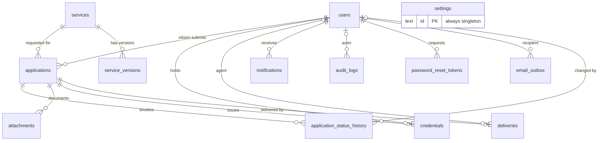

# Fast ID System: Database Design

**Version:** 1.1  **Engine:** PostgreSQL 15+  **DDL:** `schema.sql` (the source of truth, also the first migration)
**Matches:** API contract 1.0.3-mvp

---

## 1. Principles

1. **The database enforces what it can.** Every rule that can be a constraint is one (checks, unique and partial unique indexes, foreign keys). Application code adds friendly errors on top, but a bug in code cannot corrupt the data.
2. **Services are data, not code.** The form, required documents, fee and SLA of a service live in JSONB, so adding a service needs no migration.
3. **Immutable history.** Published service versions, application status history and audit logs are append-only (a trigger rejects `UPDATE` and `DELETE`).
4. **The server owns time.** Every timestamp is `timestamptz`, stored in UTC, and set by the database or the server. Clients never supply one.
5. **No secrets in plain text, with two deliberate exceptions** documented in §7: the delivery code and the QR token must be shown back to the right user.
6. **No soft delete.** Nothing is "deleted" except drafts and their files. Accounts are deactivated, services are unpublished, credentials are revoked.
7. **Files stay out of the database.** Only metadata is stored; the bytes live in the storage driver.

## 2. Entity relationship diagram



## 3. Tables at a glance

| Table | Purpose | Rows grow with | Key constraints |
|---|---|---|---|
| `users` | Citizens, admins, agents | registrations | unique email, unique national ID; citizen-only identity columns; agent-only governorate |
| `password_reset_tokens` | Single-use reset links (hash only) | reset requests | unique hash, expiry |
| `services` | Catalog entry: editable draft + availability | admin edits | slug id, publish-state check |
| `service_versions` | Frozen published definitions | publishes | PK (service, version), immutable |
| `applications` | One request by one citizen for one service | applications | one active per (citizen, service); status/decision/payment consistency checks |
| `application_status_history` | Timeline of an application | status changes | append-only |
| `attachments` | File metadata | uploads | one per (application, requirement) |
| `credentials` | Issued record with number and QR token | approvals | one per application, unique number and token |
| `deliveries` | Home delivery task | approvals | one per application, status/agent/code consistency checks |
| `notifications` | In-app notifications | status changes | read-pair check |
| `audit_logs` | Who did what | every important action | append-only |
| `email_outbox` | Emails waiting to be sent | status changes | partial index on pending rows; `locked_until` worker lease |
| `settings` | Singleton platform settings | never | `id = 'singleton'` |

## 4. Contract field to database mapping (the non-obvious ones)

| API field | Source in the database |
|---|---|
| `Application.serviceVersion` | `COALESCE(applications.service_version, services.published_version)` (`NULL` in DB while `DRAFT`; pinned on submit) |
| `Application.statusHistory[].at` | `application_status_history.created_at` (drafts write no rows; first entry is `SUBMITTED`) |
| `Application.statusHistory[].note` (citizen view) | `citizen_note` |
| `AdminApplication.statusHistory[].note` | `COALESCE(staff_note, citizen_note)` |
| `Application.isOverdue` | `due_at < now() AND status IN ('SUBMITTED','UNDER_REVIEW')` (derived) |
| `Application.decision.outcome` | `decision_outcome` (`decision_reason_code`, `decision_reason` only for `REJECTED`) |
| `Application.payment` | `payment_status`, `payment_amount` (piastres), `paid_at`, `payment_reference` (while a draft is not `PAID`, status and amount sync to the service's current published fee on read, mock payment, and submit) |
| `Application.delivery` (citizen) | assembled from `deliveries` plus the agent's name and phone; `deliveryCode` only while `status = 'OUT_FOR_DELIVERY'` (omitted on `AdminApplication`, which uses `deliveryRecord` only) |
| `Credential.status = EXPIRED` | derived: stored `ACTIVE` and `expires_at < now()` |
| `Credential.holderName` | `credentials.holder_name` (snapshot taken at issuance) |
| `AdminService.hasUnpublishedChanges` | `draft IS DISTINCT FROM (latest published definition)`, or `true` when never published |
| `Service.version`, `publishedAt` | `services.published_version`, `services.published_at` |
| `nationalIdMasked` | computed in code from `users.national_id` (first 2 and last 2 digits) |
| `Notification.entity` | `entity_type` + `entity_id` |
| `User.governorate`, `nationalId`, `birthDate`, `gender` | role-dependent columns (null for roles that do not use them) |

## 5. JSONB shapes

**`services.draft` and `service_versions.definition`** (a `ServiceDefinition`, contract §0.20 and §8):
```json
{
  "name": { "ar": "...", "en": "..." },
  "description": { "ar": "...", "en": "..." },
  "category": "IDENTITY",
  "fee": { "amount": 5000, "currency": "EGP" },
  "slaDays": 3,
  "validityYears": 7,
  "requiredDocuments": [ { "key": "personalPhoto", "label": {"ar":"","en":""}, "required": true,
                           "allowedMimeTypes": ["image/jpeg"], "maxSizeBytes": 2097152 } ],
  "formSchema": { "fields": [ { "key": "reason", "label": {"ar":"","en":""}, "helpText": null,
                                "type": "SELECT", "required": true, "options": [], "validation": {} } ] }
}
```
`id` is the table key and is never inside the JSON. The definition is validated by the application on every write (contract §8.4/§0.20 rules); the database only guarantees it is a JSON object.

**`applications.data`:** `{ "<fieldKey>": <value> }` where the value type follows the field type (string, number, `YYYY-MM-DD` string, option value, boolean). Keys always belong to the service's form schema.

**`applications.delivery_address`:** `{ "governorate": "CAIRO", "city": "...", "addressLine": "...", "phone": "01012345678", "notes": null }`. A draft may hold a partial object; a submitted application always holds all required keys.

**`notifications.title` / `body`:** `{ "ar": "...", "en": "..." }` (both keys enforced by a check).

**`audit_logs.metadata`:** a small allow-listed object, for example `{ "fromStatus": "UNDER_REVIEW", "toStatus": "APPROVED" }`, `{ "reasonCode": "INVALID_DATA" }`, `{ "version": 3 }`, `{ "agentId": "<uuid>" }`. **Never** names, national IDs, emails, phones, or free text typed by users.

**`email_outbox.payload`:** template variables only (application number, credential number, agent first name, reset link token). **Never** a password.

## 6. Invariants the database guarantees

| # | Invariant | Mechanism |
|---|---|---|
| 1 | A citizen has at most one active application per service | partial unique index `applications_one_active_per_service` |
| 2 | Only citizens have a national ID, birth date and gender; only agents have a governorate | `users_citizen_identity`, `users_agent_governorate` |
| 3 | Emails are lowercase and unique; phones are valid Egyptian mobiles | `users_email_*`, `users_phone_format` |
| 4 | A draft has no submission data; a submitted application has a valid pinned service version and a due date | `applications_submit_consistent`, composite FK `applications_service_version_fk` (`MATCH SIMPLE`) |
| 5 | Status and decision always agree (`APPROVED`/`OUT_FOR_DELIVERY`/`DELIVERED` imply an approved decision; `REJECTED` implies a rejection with a code and reason) | `applications_status_vs_outcome`, `applications_reject_reason`, `applications_decision_pair` |
| 6 | Payment fields agree (no fee means `NOT_REQUIRED`; `PAID` has a date) | `applications_payment_consistent` |
| 7 | A pending delivery has no agent; an out-for-delivery delivery has a code and a time; a delivered one has a delivery time | `deliveries_*` checks |
| 8 | One credential and one delivery per application | unique `application_id` |
| 9 | A revoked credential records who, when and why | `credentials_revocation` |
| 10 | One file per required document per application; only JPEG, PNG, PDF up to 10 MB | `attachments_*` |
| 11 | A service is `DRAFT` exactly when it was never published; the live version exists | `services_publish_state`, deferred FK `services_published_version_fk` |
| 12 | Published versions, status history and audit logs cannot be changed or deleted | triggers `sv_immutable`, `ash_append_only`, `audit_append_only` |
| 13 | Exactly one settings row | `settings_singleton` |

Deleting an application row is only possible for drafts in practice: drafts write **no** rows to `application_status_history` (the first entry is inserted on submit), so deleting a draft cascades `attachments` cleanly without hitting `ash_append_only`, while every foreign key and append-only trigger protects submitted records. The application layer never deletes anything else. Before deleting a draft, read its `attachments.storage_key` values inside the transaction and remove the stored files after commit.

## 7. Deliberate exceptions to "hash everything"

| Value | Stored as | Why | Mitigation |
|---|---|---|---|
| Password reset token | SHA-256 hash | Only needed to be compared | token is random (32 bytes), single use, 30 minutes |
| Passwords | argon2id hash | Never shown | n/a |
| **QR token** | plain | The citizen's credential page must display and encode it | 32 random bytes (unguessable), unique, only its holder and admins can read it, verification endpoint is rate limited |
| **Delivery code** (6 digits) | plain, **only while `OUT_FOR_DELIVERY`** (set back to `NULL` otherwise) | The citizen must see it in the app to tell the agent | exists for hours, locked after 5 wrong tries, cleared on delivery or failure, never returned to agents |

## 8. Indexes and the queries they serve

| Index | Serves |
|---|---|
| `users_email_unique`, `users_national_id_unique` | login by identifier, duplicate detection |
| `users_role_active_idx`, `users_*_trgm` | staff and citizen lists with search (`ILIKE '%q%'`) |
| `applications_one_active_per_service` | duplicate prevention and "find the active application for this service" |
| `applications_citizen_status_idx` | `GET /applications` (citizen list, newest first) |
| `applications_status_submitted_idx` | `GET /admin/applications` default sort and status filter |
| `applications_open_due_idx` | overdue filter and dashboard overdue count |
| `applications_number_prefix_idx` | search by application number prefix |
| `applications_governorate_idx` | `GET /admin/applications?governorate=...` and `GET /admin/deliveries?governorate=...` |
| `ash_application_idx` | status timeline of one application |
| `credentials_holder_idx` | `GET /credentials` |
| `deliveries_agent_status_idx` | `GET /agent/deliveries` and auto-assignment load count |
| `deliveries_status_created_idx` | `GET /admin/deliveries`, unassigned filter |
| `notifications_user_read_idx` | unread count and list |
| `audit_created_idx`, `audit_entity_idx`, `audit_actor_idx`, `audit_action_idx` | audit log filters |
| `outbox_pending_idx` | the email worker's "what is due" query |

Expected scale for the MVP is thousands of rows, so these are generous; they are cheap and keep the common screens instant if the data grows.

## 9. Data lifecycle and privacy

- **Retention:** nothing is purged automatically in the MVP. Expired and used `password_reset_tokens` and sent `email_outbox` rows older than 30 days are removed by a scheduled cleanup job. `FAILED` outbox rows are kept for diagnosis.
- **Personal data:** names, national IDs, emails, phones, addresses and uploaded documents. Rules: never put them in logs, audit metadata or error messages; mask national IDs in lists, CSV and public verification; serve files only through authenticated endpoints; never expose `password_hash`, `token_version`, `delivery_code` (except to the owning citizen) or storage keys.
- **Account deactivation** keeps all records (they are legal records); it only blocks login and invalidates sessions via `token_version`.
- **Backups:** daily logical dump of the database and a copy of the file storage, tested by a restore.

## 10. Migration workflow (Prisma, database-first)

1. `prisma/migrations/0001_init/migration.sql` is `schema.sql` copied verbatim. Apply with `prisma migrate deploy` on an empty database.
2. Generate the Prisma data model from the real database: `prisma db pull`, then `prisma generate`. Commit `prisma/schema.prisma`.
3. Prisma cannot describe partial indexes, triggers, CHECK constraints or deferred foreign keys. They live only in SQL migrations, which is fine because Prisma ignores what it cannot model and `db pull` keeps working.
4. Every schema change from now on is a **new SQL migration** authored manually in a timestamped folder `prisma/migrations/<YYYYMMDDHHMMSS>_<name>/migration.sql` and applied with `prisma migrate deploy`, followed by `prisma db pull` and `prisma generate`. **Never run `prisma migrate dev`** (its shadow-database diff cannot model triggers, `CHECK` constraints, partial indexes, or deferred foreign keys and would generate destructive `DROP`/`ALTER` statements). Never edit an applied migration. Commit both the SQL migration and the updated `prisma/schema.prisma`.
5. Enum changes: `ALTER TYPE ... ADD VALUE` in its own migration (it cannot run inside a transaction block together with statements that use the new value).
6. CI applies all migrations to an empty database and runs the test suite against it.

## 11. Seed and bootstrap data

| Data | When | How |
|---|---|---|
| `settings` singleton | in `schema.sql` and upserted on boot | `INSERT ... ON CONFLICT DO NOTHING` |
| First admin | on boot when no admin exists | from `SEED_ADMIN_EMAIL` and `SEED_ADMIN_PASSWORD` (`must_change_password = true`); required only when zero `ADMIN` rows exist, optional on later boots |
| Demo services (national-id, driving-license, birth-certificate) | development and demo only (`npm run seed:demo`) | same definitions as the frontend mock fixtures, published as version 1 |
| Demo agents and a demo citizen | development and demo only | same script, clearly marked as demo data |

## 12. Known limits and later improvements

- `users` holds all three roles in one table. If roles ever diverge a lot, split into profile tables; the constraints already isolate role-specific columns.
- `credential_status` stores `ACTIVE`/`REVOKED`; `EXPIRED` is derived, so no expiry job is needed.
- Free-text search uses trigram indexes (good enough for names and emails); full-text search is not needed yet.
- Partitioning of `audit_logs` and `notifications` is unnecessary at MVP scale; revisit past about 10 million rows.
